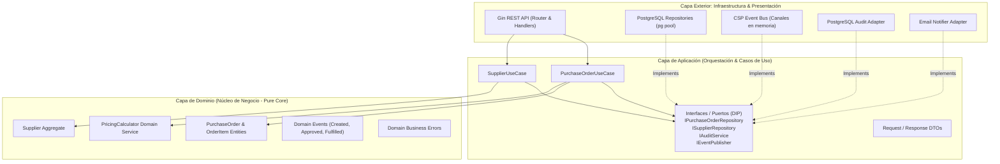

# 🧅 Microservicio de Gestión de Órdenes de Compra (Onion Architecture en Aura-Lang)

Microservicio empresarial para la gestión del ciclo de vida de **Órdenes de Compra (Purchase Orders)** y **Proveedores (Suppliers)**, desarrollado en [Aura-Lang](https://github.com/auraprojects) utilizando **Arquitectura Cebolla (Onion Architecture)** estricta y persistencia relacional en **PostgreSQL**.

---

## 🏛️ Arquitectura Cebolla (Onion Architecture)

El microservicio aplica rigurosamente la regla de dependencias de la Arquitectura Cebolla: **todas las dependencias apuntan hacia el centro**. El núcleo de dominio desconoce frameworks, drivers o bases de datos; la infraestructura implementa puertos definidos por la capa de aplicación (Inversión de Dependencias - DIP).



### 📂 Estructura de Directorios

```text
aura-order-db/
├── cmd/
│   └── server/
│       └── main.aura                      # Composition Root & Entrypoint (Inyección de Dependencias)
├── internal/
│   ├── domain/                            # 🟢 NÚCLEO DE DOMINIO (Cero dependencias externas)
│   │   ├── errors.aura                    # Errores de negocio e invariantes
│   │   ├── events.aura                    # Eventos de dominio
│   │   ├── model/
│   │   │   ├── order.aura                 # Agregado PurchaseOrder y Value Object OrderItem
│   │   │   └── supplier.aura              # Agregado Supplier
│   │   └── service/
│   │       └── pricing_calculator.aura    # Cálculo financiero (subtotales, IVA 19%, descuentos)
│   ├── application/                       # 🔵 CAPA DE APLICACIÓN (Casos de Uso)
│   │   ├── dto/
│   │   │   └── order_dto.aura             # DTOs de transferencia y mapeadores
│   │   ├── interfaces/
│   │   │   └── ports.aura                 # Puertos DIP (Interfaces de Repositorio, Notificación, Auditoría)
│   │   └── services/
│   │       ├── order_usecase.aura         # Orquestación de Órdenes de Compra
│   │       └── supplier_usecase.aura      # Orquestación de Proveedores
│   ├── infrastructure/                    # 🟡 CAPA DE INFRAESTRUCTURA (Adaptadores)
│   │   ├── config/
│   │   │   └── config.aura                # Carga de variables de entorno con defaults
│   │   ├── persistence/
│   │   │   ├── db_connection.aura         # Pool de conexiones PostgreSQL
│   │   │   ├── db_migrator.aura           # DDL migraciones y seeders automáticos
│   │   │   ├── postgres_order_repo.aura   # Adaptador PostgreSQL para PurchaseOrder
│   │   │   └── postgres_supplier_repo.aura# Adaptador PostgreSQL para Supplier
│   │   ├── messaging/
│   │   │   └── csp_event_bus.aura         # Bus de eventos basado en CSP
│   │   └── external/
│   │       ├── audit_adapter.aura         # Bitácora de auditoría en PostgreSQL
│   │       └── email_notifier.aura        # Notificador de eventos de negocio
│   └── presentation/                      # 🔴 CAPA DE PRESENTACIÓN (REST API)
│       └── http/
│           ├── health_handler.aura        # Health check con ping activo a PostgreSQL
│           ├── order_handler.aura         # Endpoints REST de Órdenes de Compra
│           ├── supplier_handler.aura      # Endpoints REST de Proveedores
│           └── router.aura                # Multiplexor Gin & middlewares (CORS)
├── scripts/
│   └── run_tests.sh                       # Ejecución secuencial de todas las suites
├── tests/
│   ├── domain_test.aura                   # 11 pruebas unitarias del núcleo de dominio
│   ├── usecase_test.aura                  # 6 pruebas de casos de uso (Mocks en memoria)
│   └── integration_test.aura              # 12 pruebas de integración contra PostgreSQL real
├── Makefile                               # Comandos de compilación, ejecución y tests
├── package.json                           # Dependencia de 'pg' para Node runtime
└── aura.mod                               # Definición del módulo Aura
```

---

## 🐘 Integración con Base de Datos PostgreSQL

El microservicio se conecta al contenedor PostgreSQL en ejecución:
- **Host / Puerto:** `127.0.0.1:5432`
- **Usuario:** `admin`
- **Contraseña:** `secret`
- **Base de Datos:** `orders_db` (creada y migrada automáticamente)

### Tablas Relacionales Creadas

1. **`suppliers`**: Registro maestro de proveedores (`id`, `name`, `email`, `tax_id`, `phone`, `address`).
2. **`purchase_orders`**: Cabecera de órdenes de compra (`id`, `order_number`, `supplier_id`, `status`, `currency`, `subtotal`, `tax_amount`, `discount_amount`, `total_amount`, `notes`, `created_by`, `created_at`, `updated_at`).
3. **`purchase_order_items`**: Detalle relacional de líneas de producto (`id`, `order_id`, `product_sku`, `product_name`, `quantity`, `unit_price`, `line_total`). Con `ON DELETE CASCADE`.
4. **`audit_logs`**: Trazabilidad completa de acciones (`action`, `entity_type`, `entity_id`, `actor`, `details`, `created_at`).

---

## 🚀 Puesta en Marcha

### Prerrequisitos
- Aura CLI (`aurac` v0.5.0) instalado.
- Node.js (v20+) y contenedor PostgreSQL activo con las credenciales indicadas.

### 1. Verificación de Tipos (Type Checking)
```bash
make check
```

### 2. Ejecutar la Suite Completa de Tests (29 Tests)
```bash
make test
# O alternativamente:
./scripts/run_tests.sh
```

### 3. Iniciar el Servidor Microservicio
```bash
make run
```
El servicio iniciará en `http://localhost:8085` tras verificar la base de datos y aplicar migraciones.

---

## 📡 Referencia de Endpoints & Ejemplos cURL

### 1. Health Check (con Ping activo a PostgreSQL)
```bash
curl -i http://localhost:8085/health
```
**Respuesta:**
```json
{
  "status": "UP",
  "service": "Aura Purchase Orders Microservice (Onion Architecture)",
  "version": "v1.0.0",
  "database": "PostgreSQL (Connected)",
  "databaseUser": "admin",
  "databaseName": "orders_db",
  "timestamp": "2026-10-18T14:16:08.326Z"
}
```

### 2. Listar Proveedores
```bash
curl -i http://localhost:8085/api/v1/suppliers
```

### 3. Registrar Nuevo Proveedor
```bash
curl -i -X POST http://localhost:8085/api/v1/suppliers \
  -H "Content-Type: application/json" \
  -d '{
    "name": "Global Hydraulic Systems",
    "email": "ventas@hydraulicglobal.com",
    "taxId": "CL-76987123-K",
    "phone": "+56-9-8877-6655",
    "address": "Av. Las Industrias 4500, Santiago"
  }'
```

### 4. Crear Orden de Compra (con cálculo de IVA 19% e ítems)
```bash
curl -i -X POST http://localhost:8085/api/v1/orders \
  -H "Content-Type: application/json" \
  -d '{
    "supplierId": "SUP-001",
    "currency": "USD",
    "notes": "Adquisición de equipamiento hidráulico Q4",
    "createdBy": "juan.perez",
    "items": [
      {
        "productSku": "SKU-VALVE-50",
        "productName": "Válvula de Presión Hidráulica 5000 PSI",
        "quantity": 2,
        "unitPrice": 750.00
      },
      {
        "productSku": "SKU-SEAL-100",
        "productName": "Kit de Empaquetaduras Industriales",
        "quantity": 10,
        "unitPrice": 25.00
      }
    ]
  }'
```

### 5. Consultar Orden por ID
```bash
curl -i http://localhost:8085/api/v1/orders/<ORDER_ID>
```

### 6. Aprobar Orden de Compra
```bash
curl -i -X POST http://localhost:8085/api/v1/orders/<ORDER_ID>/approve \
  -H "Content-Type: application/json" \
  -d '{"approvedBy": "gerente_finanzas"}'
```

### 7. Recepcionar / Cumplir Orden de Compra (Fulfill)
```bash
curl -i -X POST http://localhost:8085/api/v1/orders/<ORDER_ID>/fulfill \
  -H "Content-Type: application/json" \
  -d '{"actor": "bodega_central"}'
```

### 8. Cancelar Orden de Compra
```bash
curl -i -X POST http://localhost:8085/api/v1/orders/<ORDER_ID>/cancel \
  -H "Content-Type: application/json" \
  -d '{
    "cancelledBy": "auditor_compras",
    "reason": "Presupuesto trimestral reasignado"
  }'
```

---

## 🧪 Resumen de Pruebas Automatizadas

| Suite de Prueba | Archivo | Pruebas | Resultado | Descripción |
| :--- | :--- | :---: | :---: | :--- |
| **Domain Core** | `tests/domain_test.aura` | 11 | **11 PASSED** | Invariantes de agregado, máquina de estados, pricing e IVA 19% |
| **Application Layer** | `tests/usecase_test.aura` | 6 | **6 PASSED** | Orquestación de casos de uso con inversión de dependencias y mocks |
| **PostgreSQL Integration** | `tests/integration_test.aura` | 12 | **12 PASSED** | Conexión activa, DDL, queries transaccionales, auditoría y REST API Gin |
| **Total** | | **29** | **29 PASSED (100%)** | |
